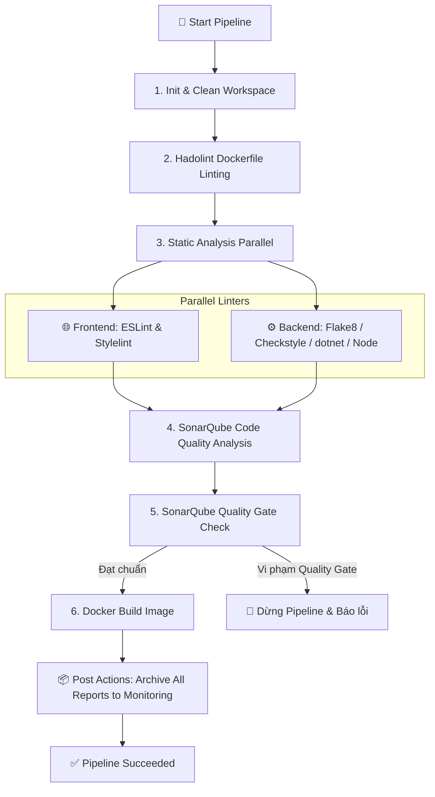

# 🚀 Production CI/CD Pipeline Infrastructure 2026

Bộ hạ tầng **CI/CD Pipeline** chuẩn hóa hoàn chỉnh dành cho doanh nghiệp và các nhóm phát triển phần mềm. Hệ thống tích hợp toàn bộ các dịch vụ từ nguồn chính thức (**Official Upstream Docker Compose**), bộ rà soát mã nguồn (**Static Analyzers / Linters**) tách biệt rõ ràng giữa **Frontend (FE)** và **Backend (BE)**, cùng trung tâm **Monitoring** quản lý tập trung toàn bộ nhật ký (Logs) và báo cáo chất lượng mã nguồn (Reports).

---

## 📑 Mục lục
1. [Kiến trúc & Cấu trúc thư mục](#-kiến-trúc--cấu-trúc-thư-mục)
2. [Bảng đối chiếu công cụ quét mã nguồn (FE & BE)](#-bảng-đối-chiếu-công-cụ-quét-mã-nguồn-fe--be)
3. [Yêu cầu hệ thống (Prerequisites)](#-yêu-cầu-hệ-thống-prerequisites)
4. [Cấu hình biến môi trường (.env)](#-cấu-hình-biến-môi-trường-env)
5. [Hướng dẫn cài đặt & Khởi chạy (Quick Start)](#-hướng-dẫn-cài-đặt--khởi-chạy-quick-start)
   - [Cách 1: Khởi động tự động qua Makefile (Khuyến nghị)](#cách-1-khởi-động-tự-động-qua-makefile-khuyến-nghị)
   - [Cách 2: Khởi động bằng Docker Compose](#cách-2-khởi-động-bằng-docker-compose)
   - [Cách 3: Khởi động từng dịch vụ độc lập](#cách-3-khởi-động-từng-dịch-vụ-độc-lập)
6. [Thông tin truy cập & Cấu hình dịch vụ](#-thông-tin-truy-cập--cấu-hình-dịch-vụ)
   - [Jenkins CI/CD](#1-jenkins-cicd)
   - [SonarQube & PostgreSQL](#2-sonarqube--postgresql)
   - [Dozzle Realtime Log Viewer](#3-dozzle-realtime-log-viewer)
7. [Hướng dẫn chạy bộ quét mã nguồn (Scanners)](#-hướng-dẫn-chạy-bộ-quét-mã-nguồn-scanners)
8. [Quy trình hoạt động của Jenkins Pipeline](#-quy-trình-hoạt-động-của-jenkins-pipeline)
9. [Bảng lệnh tắt điều khiển (Makefile Cheat Sheet)](#-bảng-lệnh-tắt-điều-khiển-makefile-cheat-sheet)
10. [Xử lý sự cố thường gặp (Troubleshooting)](#-xử-lý-sự-cố-thường-gặp-troubleshooting)

---

## 📁 Kiến trúc & Cấu trúc thư mục

```text
CI-CD_Pipeline_2026_DGDoC/
│
├── .env.example                          # Template mẫu biến môi trường (port, passwords, images)
├── .env                                  # File cấu hình biến môi trường cục bộ
├── .gitignore                            # Quy tắc Git: loại bỏ rác build, giữ nguyên cấu trúc .gitkeep
├── Makefile                              # Bộ phím tắt điều khiển: setup, up, down, scan, logs...
├── docker-compose.yml                    # Master Compose: Kết nối tất cả dịch vụ trên cùng 1 network
├── README.md                             # Tài liệu kỹ thuật chi tiết của toàn bộ dự án
│
├── Jenkins/                              # 🏗️ Dịch vụ Jenkins CI/CD Automation
│   ├── docker-compose.yml                # Official Jenkins LTS Compose (Docker-in-Docker socket)
│   ├── Dockerfile                        # Jenkins custom image có cài sẵn Docker CLI chính thức
│   ├── Jenkinsfile                       # Kịch bản Declarative Pipeline đa giai đoạn (Multi-stage)
│   └── README.md                         # Hướng dẫn chi tiết sử dụng Jenkins
│
├── SonarQube/                            # 🔍 Dịch vụ SonarQube Code Quality & Security
│   ├── docker-compose.yml                # Official SonarQube Community LTS + PostgreSQL 15
│   └── README.md                         # Hướng dẫn chi tiết sử dụng SonarQube
│
├── Dozzle/                               # 📜 Dịch vụ Giám sát Logs Container Thời Gian Thực
│   ├── docker-compose.yml                # Official Dozzle Compose (đọc trực tiếp docker.sock:ro)
│   └── README.md                         # Hướng dẫn chi tiết sử dụng Dozzle
│
├── Hadolint/                             # 🐳 Công cụ rà soát cú pháp và bảo mật Dockerfile
│   ├── docker-compose.yml                # Official Hadolint container runner
│   ├── .hadolint.yaml                    # Bộ quy tắc kiểm duyệt chuẩn mực cho Dockerfile
│   └── README.md                         # Hướng dẫn chạy Hadolint
│
├── code_scanners/                        # 🛡️ Bộ công cụ phân tích tĩnh mã nguồn (Linters & SAST)
│   ├── README.md                         # Bảng đối chiếu tương quan giữa Flake8 và các ngôn ngữ
│   │
│   ├── frontend/                         # 🌐 FRONTEND SCANNERS
│   │   ├── react-eslint/                 # ESLint cho React / JS / TS (Tương đương Flake8)
│   │   │   ├── .eslintrc.json            # Cấu hình rules: React Hooks, JSX Accessibility, ES6+
│   │   │   ├── package.json              # Khai báo dependency và script xuất báo cáo JSON/HTML
│   │   │   └── README.md
│   │   └── stylelint/                    # Stylelint cho CSS / SCSS
│   │       ├── .stylelintrc.json         # Quy tắc chuẩn hóa stylesheet, chống duplicate properties
│   │       └── README.md
│   │
│   └── backend/                          # ⚙️ BACKEND SCANNERS
│       ├── python-flake8/                # Flake8 cho Python
│       │   ├── .flake8                   # Cấu hình chuẩn PEP 8, PyFlakes, McCabe (Max complexity=10)
│       │   └── README.md
│       ├── java-checkstyle/              # Checkstyle cho Java (Tương đương Flake8)
│       │   ├── checkstyle.xml            # Sun/Google checks: Naming conventions, imports, braces
│       │   └── README.md
│       ├── csharp-dotnet-format/         # dotnet format & Roslyn Analyzers cho C# (.NET)
│       │   ├── .editorconfig             # Quy chuẩn Microsoft cho format code và mã lỗi CS/SA
│       │   └── README.md
│       └── nodejs-eslint/                # ESLint cho Backend Node.js
│           ├── .eslintrc.json            # Plugin Node.js và Plugin Security (chống injection/traversal)
│           ├── package.json              # Scripts xuất báo cáo JSON/HTML
│           └── README.md
│
├── monitoring/                           # 📊 TRUNG TÂM QUẢN LÝ NHẬT KÝ & BÁO CÁO TẬP TRUNG
│   ├── README.md                         # Tài liệu kiến trúc monitoring
│   ├── logs/                             # Nơi mount nhật ký tự động từ các container
│   │   ├── jenkins/                      # Nhật ký Jenkins master
│   │   ├── sonarqube/                    # Nhật ký SonarQube server và Elasticsearch
│   │   └── dozzle/                       # Nhật ký Dozzle
│   └── reports/                          # Nơi lưu trữ báo cáo rà soát mã nguồn đầu ra
│       ├── frontend/
│       │   ├── eslint/                   # Báo cáo React/JS/TS (eslint-report.json, html)
│       │   └── stylelint/                # Báo cáo CSS/SCSS (stylelint-report.json)
│       ├── backend/
│       │   ├── flake8/                   # Báo cáo Python (flake8-report.txt, html)
│       │   ├── checkstyle/               # Báo cáo Java (checkstyle-result.xml)
│       │   ├── csharp/                   # Báo cáo C# (format và analyzer txt/json)
│       │   └── nodejs/                   # Báo cáo Node.js backend (json, html)
│       └── hadolint/                     # Báo cáo rà soát Dockerfile (json)
│
├── scripts/                              # ⚙️ Kịch bản tự động hóa (Automation Scripts)
│   ├── setup-environment.sh              # 1-Click thiết lập môi trường (.env, directories, network)
│   └── run-scanners.sh                   # Chạy tự động tất cả hoặc từng nhóm linter cục bộ
│
└── .github/workflows/                    # 🤖 GitHub Actions Workflow
    └── ci.yml                            # CI pipeline tự động kích hoạt khi push code lên GitHub
```

---

## 🔍 Bảng đối chiếu công cụ quét mã nguồn (FE & BE)

Dự án sử dụng **Flake8** làm tiêu chuẩn mẫu để đối chiếu và lựa chọn các công cụ tương đương cho từng ngôn ngữ:

| Phân hệ | Ngôn ngữ / Nền tảng | Công cụ tương đương Flake8 | Trách nhiệm chính trong Pipeline | Thư mục cấu hình |
| :--- | :--- | :--- | :--- | :--- |
| **Frontend** | **React / JS / TS** | **ESLint** (+ React & Hooks plugins) | Kiểm tra lỗi cú pháp, biến chưa dùng, quy tắc bắt buộc của React Hooks, chuẩn tiếp cận JSX | [`code_scanners/frontend/react-eslint/`](file:///Users/penpen1112003/CI-CD_Pipeline_2026_DGDoC/code_scanners/frontend/react-eslint/) |
| **Frontend** | **CSS / SCSS** | **Stylelint** | Chuẩn hóa style, chống trùng lặp thuộc tính, giới hạn độ lồng nhau (max nesting depth) | [`code_scanners/frontend/stylelint/`](file:///Users/penpen1112003/CI-CD_Pipeline_2026_DGDoC/code_scanners/frontend/stylelint/) |
| **Backend** | **Python** | **Flake8** | Tuân thủ PEP 8, phát hiện import thừa/sai cú pháp (PyFlakes), giới hạn độ phức tạp chu trình (McCabe) | [`code_scanners/backend/python-flake8/`](file:///Users/penpen1112003/CI-CD_Pipeline_2026_DGDoC/code_scanners/backend/python-flake8/) |
| **Backend** | **Java** | **Checkstyle** (+ PMD / SpotBugs) | Quy ước đặt tên (CamelCase), tránh wildcard import (`*`), kiểm tra Javadoc và Cyclomatic Complexity | [`code_scanners/backend/java-checkstyle/`](file:///Users/penpen1112003/CI-CD_Pipeline_2026_DGDoC/code_scanners/backend/java-checkstyle/) |
| **Backend** | **C# / .NET** | **dotnet format & Roslyn Analyzers** | Chuẩn hóa định dạng mã nguồn C#, thực thi quy tắc biên dịch mã lỗi CS/SA qua file `.editorconfig` | [`code_scanners/backend/csharp-dotnet-format/`](file:///Users/penpen1112003/CI-CD_Pipeline_2026_DGDoC/code_scanners/backend/csharp-dotnet-format/) |
| **Backend** | **Node.js** | **ESLint** (+ Node & Security plugins) | Phát hiện anti-patterns của server-side JavaScript/TypeScript, phát hiện lỗ hổng bảo mật injection/path traversal | [`code_scanners/backend/nodejs-eslint/`](file:///Users/penpen1112003/CI-CD_Pipeline_2026_DGDoC/code_scanners/backend/nodejs-eslint/) |
| **DevOps** | **Dockerfile** | **Hadolint** | Phân tích cú pháp Dockerfile AST, rà soát best practices tối ưu dung lượng và bảo mật container | [`Hadolint/`](file:///Users/penpen1112003/CI-CD_Pipeline_2026_DGDoC/Hadolint/) |

---

## 💻 Yêu cầu hệ thống (Prerequisites)

Trước khi khởi chạy hệ thống, đảm bảo môi trường máy chủ hoặc máy trạm đáp ứng các yêu cầu sau:

1. **Phần cứng khuyến nghị**:
   - **CPU**: Tối thiểu 2 Cores (Khuyến nghị 4 Cores).
   - **RAM**: Tối thiểu 4 GB (Khuyến nghị 8 GB trở lên vì SonarQube tích hợp Elasticsearch bên trong).
   - **Ổ đĩa trống**: Tối thiểu 15 GB SSD.

2. **Phần mềm cần cài đặt**:
   - **Docker Engine**: Version `20.10.x` trở lên ([Cài đặt Docker](https://docs.docker.com/get-docker/)).
   - **Docker Compose**: Plugin v2 (`docker compose`) hoặc Docker Desktop.
   - **Make**: (Tùy chọn, để dùng các phím tắt tiện lợi).

3. **Cấu hình Kernel đối với Linux Host (Bắt buộc cho SonarQube)**:
   Do SonarQube sử dụng Elasticsearch, trên hệ điều hành Linux bạn cần tăng giới hạn bộ nhớ ảo:
   ```bash
   sudo sysctl -w vm.max_map_count=524288
   sudo sysctl -w fs.file-max=131072
   # Để cố định sau khi reboot, thêm vào /etc/sysctl.conf:
   echo "vm.max_map_count=524288" | sudo tee -a /etc/sysctl.conf
   echo "fs.file-max=131072" | sudo tee -a /etc/sysctl.conf
   ```

---

## ⚙️ Cấu hình biến môi trường (.env)

Tất cả các tham số của hệ thống được quản lý thông qua file [`.env`](file:///Users/penpen1112003/CI-CD_Pipeline_2026_DGDoC/.env). Nếu chưa có, bạn chỉ cần copy từ [`.env.example`](file:///Users/penpen1112003/CI-CD_Pipeline_2026_DGDoC/.env.example):

```bash
cp .env.example .env
```

| Tên biến | Giá trị mặc định | Giải thích chi tiết |
| :--- | :--- | :--- |
| `COMPOSE_PROJECT_NAME` | `cicd_pipeline_2026` | Tên tiền tố cho các container và network của Compose |
| `PIPELINE_NETWORK_NAME` | `cicd_pipeline_network` | Tên Docker bridge network kết nối các container với nhau |
| `JENKINS_IMAGE` | `jenkins/jenkins:lts-jdk17` | Image chính thức của Jenkins phiên bản Long-Term Support |
| `JENKINS_PORT` | `8080` | Cổng truy cập Web UI của Jenkins |
| `JENKINS_AGENT_PORT` | `50000` | Cổng kết nối Jenkins Inbound Agents (JNLP) |
| `SONARQUBE_IMAGE` | `sonarqube:lts-community` | Image SonarQube Community LTS chính thức |
| `SONARQUBE_PORT` | `9000` | Cổng truy cập giao diện quản trị SonarQube |
| `SONAR_DB_USER` | `sonar` | Tên người dùng cơ sở dữ liệu PostgreSQL cho SonarQube |
| `SONAR_DB_PASSWORD` | `sonar_secure_password_2026` | Mật khẩu cơ sở dữ liệu PostgreSQL cho SonarQube |
| `SONAR_DB_NAME` | `sonar` | Tên cơ sở dữ liệu SonarQube |
| `POSTGRES_IMAGE` | `postgres:15-alpine` | Image PostgreSQL chính thức (bản alpine nhẹ và ổn định) |
| `DOZZLE_IMAGE` | `amir20/dozzle:latest` | Image Dozzle Realtime Log Viewer chính thức |
| `DOZZLE_PORT` | `8888` | Cổng truy cập Web UI xem log của Dozzle |
| `DOZZLE_LOG_LEVEL` | `info` | Cấp độ log của Dozzle |
| `HADOLINT_IMAGE` | `hadolint/hadolint:latest-debian`| Image Hadolint linter Dockerfile |

---

## 🚀 Hướng dẫn cài đặt & Khởi chạy (Quick Start)

### Cách 1: Khởi động tự động qua Makefile (Khuyến nghị)

Đây là cách đơn giản và nhanh nhất, script sẽ tự động tạo thư mục, sinh file `.env`, cấp quyền và khởi động hệ thống:

```bash
# Bước 1: Khởi tạo môi trường
make setup

# Bước 2: Khởi chạy toàn bộ hệ thống ở chế độ ngầm (Background)
make up

# Bước 3: Kiểm tra trạng thái hoạt động của các container
make ps
```

---

### Cách 2: Khởi động bằng Docker Compose

Nếu môi trường của bạn không cài đặt lệnh `make`, bạn có thể thực hiện trực tiếp:

```bash
# 1. Chạy script chuẩn bị môi trường
./scripts/setup-environment.sh

# 2. Tạo network nếu chưa có
docker network create cicd_pipeline_network || true

# 3. Khởi chạy toàn bộ hệ sinh thái
docker compose up -d

# 4. Xem logs realtime
docker compose logs -f
```

---

### Cách 3: Khởi động từng dịch vụ độc lập

Mỗi dịch vụ đều có file `docker-compose.yml` độc lập trong thư mục riêng để bạn khởi động riêng lẻ theo nhu cầu:

#### 1. Khởi động riêng Jenkins:
```bash
docker network create cicd_pipeline_network || true
cd Jenkins
docker compose up -d
```

#### 2. Khởi động riêng SonarQube & PostgreSQL:
```bash
docker network create cicd_pipeline_network || true
cd SonarQube
docker compose up -d
```

#### 3. Khởi động riêng Dozzle (Log Viewer):
```bash
docker network create cicd_pipeline_network || true
cd Dozzle
docker compose up -d
```

---

## 🌐 Thông tin truy cập & Cấu hình dịch vụ

### 1. Jenkins CI/CD
- **Địa chỉ truy cập**: [http://localhost:8080](http://localhost:8080)
- **Lấy mật khẩu quản trị ban đầu**:
  ```bash
  docker exec jenkins-lts cat /var/jenkins_home/secrets/initialAdminPassword
  ```
- **Thiết lập Pipeline**:
  1. Đăng nhập vào Jenkins -> Chọn **New Item** -> Nhập tên dự án -> Chọn **Pipeline**.
  2. Tại mục **Pipeline Definition**, chọn **Pipeline script from SCM** (Git) hoặc copy nội dung từ file [`Jenkins/Jenkinsfile`](file:///Users/penpen1112003/CI-CD_Pipeline_2026_DGDoC/Jenkins/Jenkinsfile).
  3. Đường dẫn Script: `Jenkins/Jenkinsfile`.

### 2. SonarQube & PostgreSQL
- **Địa chỉ truy cập**: [http://localhost:9000](http://localhost:9000)
- **Tài khoản mặc định**: `admin` / `admin`
- *(Lưu ý: Hệ thống sẽ bắt buộc đổi mật khẩu mới ở lần đăng nhập đầu tiên).*
- **Tạo Token tích hợp CI/CD**:
  1. Vào **Administration** -> **Security** -> **Users** -> Chọn user `admin` -> Click **Tokens**.
  2. Tạo token mới (ví dụ: `jenkins-scanner-token`) và lưu lại để sử dụng trong Jenkinsfile hoặc pipeline script.

### 3. Dozzle Realtime Log Viewer
- **Địa chỉ truy cập**: [http://localhost:8888](http://localhost:8888)
- **Tính năng**: Xem stream trực tiếp toàn bộ log của Jenkins, SonarQube, PostgreSQL và các containers mà không cần gõ lệnh `docker logs`. Tìm kiếm và lọc log theo thời gian thực cực kỳ thuận tiện.

---

## 🧪 Hướng dẫn chạy bộ quét mã nguồn (Scanners)

Bạn có thể chạy thử nghiệm hoặc quét mã nguồn thủ công bất kỳ lúc nào mà không bắt buộc phải kích hoạt Jenkins:

### 1. Chạy thông qua Makefile
```bash
# Quét toàn bộ (Hadolint + Frontend + Backend)
make scan

# Chỉ quét Frontend (React ESLint & Stylelint)
make scan-fe

# Chỉ quét Backend (Flake8 Python, Checkstyle Java, C# dotnet format)
make scan-be

# Chỉ quét Dockerfile với Hadolint
make scan-docker
```

### 2. Chạy thông qua Script tự động
```bash
./scripts/run-scanners.sh all         # Quét tất cả
./scripts/run-scanners.sh frontend    # Quét Frontend
./scripts/run-scanners.sh backend     # Quét Backend
./scripts/run-scanners.sh hadolint    # Quét Dockerfile
```

### 3. Xem báo cáo đầu ra
Sau khi hoàn tất, toàn bộ báo cáo sẽ tự động lưu về:
- **Frontend ESLint Report**: [`monitoring/reports/frontend/eslint/`](file:///Users/penpen1112003/CI-CD_Pipeline_2026_DGDoC/monitoring/reports/frontend/eslint/)
- **Backend Flake8 Report**: [`monitoring/reports/backend/flake8/`](file:///Users/penpen1112003/CI-CD_Pipeline_2026_DGDoC/monitoring/reports/backend/flake8/)
- **Java Checkstyle Report**: [`monitoring/reports/backend/checkstyle/`](file:///Users/penpen1112003/CI-CD_Pipeline_2026_DGDoC/monitoring/reports/backend/checkstyle/)
- **C# Format Report**: [`monitoring/reports/backend/csharp/`](file:///Users/penpen1112003/CI-CD_Pipeline_2026_DGDoC/monitoring/reports/backend/csharp/)
- **Hadolint Docker Report**: [`monitoring/reports/hadolint/`](file:///Users/penpen1112003/CI-CD_Pipeline_2026_DGDoC/monitoring/reports/hadolint/)

---

## 🔄 Quy trình hoạt động của Jenkins Pipeline

Kịch bản [`Jenkins/Jenkinsfile`](file:///Users/penpen1112003/CI-CD_Pipeline_2026_DGDoC/Jenkins/Jenkinsfile) thực thi theo chu trình chuẩn sau:



---

## 🛠 Bảng lệnh tắt điều khiển (Makefile Cheat Sheet)

| Lệnh | Chức năng thực hiện |
| :--- | :--- |
| `make setup` | Chuẩn bị môi trường tự động (sinh `.env`, tạo network, cấp quyền) |
| `make up` | Khởi chạy toàn bộ cụm dịch vụ Jenkins, SonarQube, PostgreSQL, Dozzle |
| `make down` | Dừng và giải phóng tài nguyên các dịch vụ |
| `make restart` | Khởi động lại các container dịch vụ |
| `make ps` | Liệt kê danh sách và trạng thái các container |
| `make logs` | Xem stream log của toàn bộ hệ thống qua CLI |
| `make scan` | Chạy nhanh toàn bộ bộ rà soát mã nguồn (FE, BE, Hadolint) |
| `make scan-fe` | Chỉ quét mã nguồn Frontend (React ESLint & Stylelint) |
| `make scan-be` | Chỉ quét mã nguồn Backend (Flake8, Checkstyle, C#) |
| `make scan-docker` | Chỉ quét Dockerfile bằng Hadolint |
| `make clean` | Dọn dẹp các tệp log và report phát sinh trước khi commit |

---

## 🩺 Xử lý sự cố thường gặp (Troubleshooting)

### 1. SonarQube bị Crash hoặc thoát liên tục (Exit Code 137 / 78)
- **Nguyên nhân**: Elasticsearch tích hợp trong SonarQube yêu cầu tham số kernel `vm.max_map_count >= 262144`.
- **Cách khắc phục**:
  ```bash
  sudo sysctl -w vm.max_map_count=524288
  sudo sysctl -w fs.file-max=131072
  ```

### 2. Lỗi Permission denied khi ghi Log vào thư mục `monitoring/logs`
- **Nguyên nhân**: Container chạy với UID khác (ví dụ UID 1000 của Jenkins/SonarQube) không có quyền ghi vào thư mục host.
- **Cách khắc phục**:
  ```bash
  chmod -R 777 monitoring/logs monitoring/reports
  ```

### 3. Lỗi không kết nối được Docker Socket (`/var/run/docker.sock`)
- **Nguyên nhân**: Jenkins hoặc Dozzle không có quyền truy cập vào socket Docker của máy chủ.
- **Cách khắc phục**: Đảm bảo dịch vụ Docker daemon đang chạy trên máy và user hiện tại thuộc group `docker`:
  ```bash
  sudo usermod -aG docker $USER
  ```

### 4. Dừng hoàn toàn và xóa sạch volumes dữ liệu để reset từ đầu
```bash
docker compose down -v
make setup
make up
```

---

## 👥 Đóng góp & Tái sử dụng (Reusability)

Kho lưu trữ này được thiết kế để bất kỳ thành viên nào trong nhóm hoặc cộng đồng có thể clone về sử dụng ngay lập tức mà không cần chỉnh sửa sâu hệ thống. Mọi đóng góp (Pull Request / Issue) nhằm tối ưu hóa thêm các bộ linter hoặc nâng cấp phiên bản dịch vụ đều được hoan nghênh!